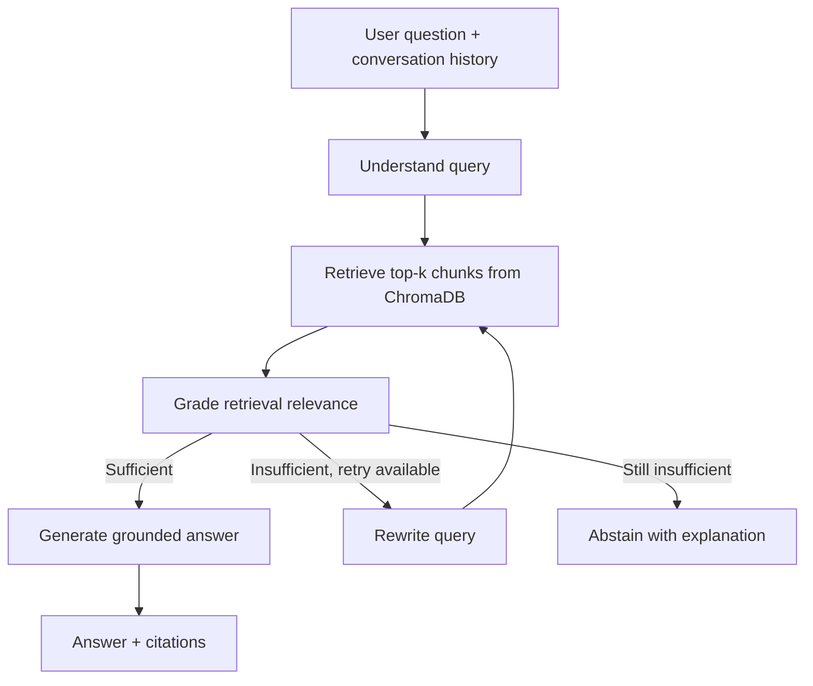

# Agentic RAG System Using LangGraph

A conversational retrieval-augmented generation application that answers questions using two official NIST sources:

1. NIST AI Risk Management Framework (AI RMF 1.0)
2. NIST AI RMF: Generative Artificial Intelligence Profile

The orchestration is implemented with LangGraph. ChromaDB stores embeddings persistently, Sentence Transformers creates local embeddings, and Groq provides the chat model.

## Architecture



## Project structure

```text
nist_agentic_rag/
├── app.py
├── requirements.txt
├── .env.example
├── README.md
├── data/
│   └── raw/                 # downloaded PDFs
├── chroma_db/               # created after ingestion
└── src/
    ├── __init__.py
    ├── config.py
    ├── ingest.py
    └── graph.py
```

## 1. Requirements

- Python 3.10+
- A Groq API key
- Internet access for downloading the NIST PDFs and installing dependencies

## 2. Installation

```bash
git clone <your-repository-url>
cd nist_agentic_rag

python -m venv .venv
source .venv/bin/activate       # macOS/Linux
# .venv\Scripts\activate        # Windows

pip install -r requirements.txt
```

## 3. Configuration

```bash
cp .env.example .env
```

Add your Groq API key to `.env`:

```env
GROQ_API_KEY=your_actual_key
GROQ_MODEL=llama-3.3-70b-versatile
EMBEDDING_MODEL=sentence-transformers/all-MiniLM-L6-v2
CHROMA_DIR=./chroma_db
COLLECTION_NAME=nist_ai_rmf
TOP_K=5
MIN_RELEVANCE_SCORE=0.25
```

Use a model currently available to your Groq account if the default model has been retired or is unavailable.

## 4. Ingest the NIST documents

```bash
python -m src.ingest
```

The ingestion script:
1. Downloads AI RMF 1.0 from the official NIST PDF URL.
2. Finds the Generative AI Profile PDF linked from its official NIST publication page.
3. Extracts text page by page with PyMuPDF.
4. Splits pages into overlapping chunks.
5. Retains document name, PDF page number, section (best-effort), filename and chunk offset.
6. Embeds chunks locally and persists them in ChromaDB.

If NIST changes its publication page and automatic PDF discovery fails, download the profile PDF manually and save it as `data/raw/nist_genai_profile.pdf`, then rerun ingestion.

## 5. Run the application

```bash
python app.py
```

Example:

```text
You: What are the four core functions of the NIST AI RMF?

Assistant: The four core functions are Govern, Map, Measure, and Manage...
Sources:
- NIST AI RMF 1.0 | Page ... | ...
```

Follow-up examples:

```text
You: Which of these functions is cross-cutting?
You: Why is it considered cross-cutting?
```

The CLI retains the last five user/assistant exchanges and passes them to the query-understanding node.

## Design decisions

### Chunking

The application first extracts one document per PDF page, then uses `RecursiveCharacterTextSplitter` with a 900-character chunk size and 150-character overlap. Page-level splitting makes page attribution reliable and avoids chunks silently spanning page boundaries. The overlap helps preserve context near chunk boundaries. Section detection is heuristic, so a section may be reported as `Not detected` or may carry forward from a previous page.

### Embeddings and vector store

`sentence-transformers/all-MiniLM-L6-v2` is small, fast, and runs locally, avoiding embedding API cost. ChromaDB is selected because it is easy to set up and supports persistent local storage. For a larger production corpus, evaluate a managed vector database and benchmark domain-specific embedding models.

### Retrieval

The graph retrieves the top five chunks using vector similarity. The relevance score is compared against a configurable threshold. This is a lightweight retrieval-quality gate, not a perfect semantic relevance classifier. The threshold should be calibrated using a small test set of relevant and irrelevant questions.

### LangGraph workflow

- `understand_query`: uses recent conversation history to turn follow-up questions into standalone search queries.
- `retrieve`: searches ChromaDB and prepares context with provenance metadata.
- `grade_retrieval`: checks whether any retrieved result clears the relevance threshold.
- `rewrite_query`: creates one alternative query if retrieval is weak.
- `generate_answer`: answers only from retrieved context and asks the model to cite document, page and section.
- `insufficient_context`: abstains when retrieval remains weak.

The graph has one bounded retry to avoid an infinite retrieval loop.

### Conversation context

The CLI stores a rolling list of recent user and assistant turns in memory. The graph uses it to rewrite follow-up questions. The history is not persisted between application restarts.

### Source attribution

Every chunk contains `source`, `page`, and `section` metadata. These fields are injected into the model context and also printed in a source list. The answer prompt instructs the model not to invent citations. For a production-grade citation system, validate cited page/section references against the retrieved metadata after generation.

## Known limitations

- Section extraction is heuristic and should be improved for complex PDF layouts.
- A similarity threshold is a simple relevance check; it is not a learned relevance grader.
- The application has one query rewrite retry.
- Conversation history is in-memory only.
- The answer's inline citations are generated by the LLM; a production system should validate every citation against retrieved chunks.
- PDF extraction quality depends on the source PDF text layer. OCR would be needed for scanned pages.
- No authentication, API layer, UI, automated evaluation suite, or multi-user session store is included because the assignment asks for a small demonstration.

## Suggested evaluation questions

1. What are the four core functions of the NIST AI RMF?
2. Which AI RMF function is cross-cutting?
3. What is the purpose of the Govern function?
4. What are the major risks discussed in the NIST Generative AI Profile?
5. What does the framework say about measuring AI risks?
6. What is an unrelated question, such as “Who won the FIFA World Cup?”, to test abstention?
7. Ask a follow-up such as “Which one is cross-cutting?” after asking about the four functions.

## Before submission

- Run ingestion and confirm both PDFs were indexed.
- Test direct questions, follow-up questions, and unrelated questions.
- Check that cited pages actually support the answer.
- Add a few screenshots or a short terminal demo to the submission if permitted.
- Commit `.env.example`, never the real `.env` or API key.
# Whitecrow_Assignment
