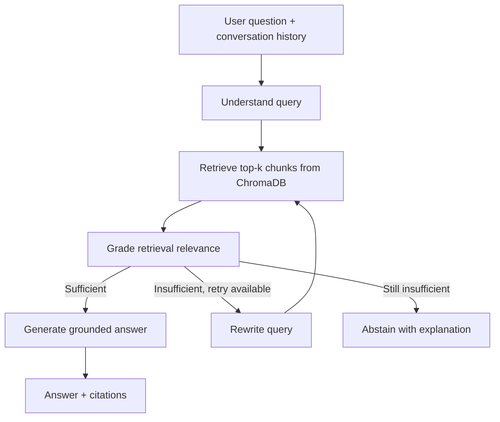

# Agentic RAG System Using LangGraph

A conversational retrieval-augmented generation application that answers questions using two official NIST sources:

1. NIST AI Risk Management Framework (AI RMF 1.0)
2. NIST AI RMF: Generative Artificial Intelligence Profile

Orchestration is implemented with LangGraph. ChromaDB stores embeddings, Sentence Transformers creates local embeddings, and Groq provides the chat model. A small web UI and a CLI are both included.

## Architecture



## Project structure

```text
nist_agentic_rag/
├── api.py                   # FastAPI app + web UI
├── app.py                   # optional CLI
├── requirements.txt
├── .env.example
├── README.md
├── static/                  # chat frontend
├── data/raw/                # downloaded PDFs
├── chroma_db/               # created after ingestion
└── src/
    ├── config.py
    ├── ingest.py
    └── graph.py
```

## 1. Requirements

- Python 3.10–3.12 (3.12 recommended; some embedding/ONNX wheels are not available on 3.14 yet)
- A Groq API key
- Internet access for downloading the NIST PDFs and installing dependencies

## 2. Installation

```bash
cd nist_agentic_rag
python -m venv .venv
source .venv/bin/activate       # macOS/Linux
# .venv\Scripts\activate        # Windows
pip install -r requirements.txt
```

## 3. Configuration

```bash
cp .env.example .env
```

Add your Groq API key to `.env`:

```env
GROQ_API_KEY=your_actual_key
GROQ_MODEL=llama-3.3-70b-versatile
EMBEDDING_MODEL=sentence-transformers/all-MiniLM-L6-v2
CHROMA_DIR=./chroma_db
COLLECTION_NAME=nist_ai_rmf
TOP_K=5
MIN_RELEVANCE_SCORE=0.25
```

Use a model currently available to your Groq account if the default model is unavailable.

## 4. Ingest the NIST documents

Ingestion also runs automatically the first time the web app starts. To ingest manually:

```bash
python -m src.ingest
```

Rebuild even if a database already exists:

```bash
python -m src.ingest --force
```

The ingestion script:

1. Downloads AI RMF 1.0 from the official NIST PDF URL.
2. Finds the Generative AI Profile PDF from its official NIST publication page, with a known NIST PDF URL as fallback.
3. Extracts text page by page with PyMuPDF.
4. Splits pages into overlapping chunks.
5. Retains document name, PDF page number, section (best-effort), filename and chunk offset.
6. Embeds chunks locally and persists them in ChromaDB.

If automatic PDF discovery fails, save the profile PDF as `data/raw/nist_genai_profile.pdf` and rerun ingestion.

## 5. Run the application

Web UI (recommended):

```bash
uvicorn api:app --reload --port 8000
```

Open [http://127.0.0.1:8000](http://127.0.0.1:8000). The UI keeps recent turns in the browser and sends them with each question so follow-ups work.

Optional CLI:

```bash
python app.py
```

Interactive API docs are at `/docs`.

## Example questions

1. What are the four core functions of the NIST AI RMF?
2. Which of these functions is cross-cutting?
3. What is the purpose of the Govern function?
4. What major risks does the NIST Generative AI Profile discuss?
5. What does the framework say about measuring AI risks?
6. Who won the FIFA World Cup? (should abstain)
7. After asking about the four functions: “Which one is cross-cutting?”

## Design decisions

### Chunking

The pipeline extracts one document per PDF page, then uses `RecursiveCharacterTextSplitter` with a 900-character chunk size and 150-character overlap. Page-level splitting keeps page attribution reliable. Overlap preserves sentences that sit on chunk boundaries. Section detection is heuristic; a section may be reported as `Not detected` or may carry forward from a previous page.

### Embeddings and vector store

`sentence-transformers/all-MiniLM-L6-v2` is small, fast, and local, so embeddings do not consume Groq quota. ChromaDB is a persistent local store with a short setup path. A larger production corpus would deserve a managed vector database and a domain-specific embedding comparison.

### Retrieval

The graph retrieves the top five chunks by vector similarity. The best relevance score is compared with `MIN_RELEVANCE_SCORE`. That is a lightweight quality gate, not a trained relevance classifier.

### LangGraph workflow

- `understand_query`: turns follow-ups into a standalone search query using recent conversation history.
- `retrieve`: searches ChromaDB and attaches provenance metadata.
- `grade_retrieval`: accepts the context only if the best score clears the threshold.
- `rewrite_query`: produces one alternative query when retrieval is weak.
- `generate_answer`: answers from retrieved context plus conversation history, and asks the model to cite document, page, and section.
- `insufficient_context`: abstains when retrieval remains weak.

There is one bounded retry so the graph cannot loop forever.

### Conversation context

The UI and CLI keep a short rolling history of user and assistant turns. The graph uses that history twice: once to rewrite the search query, and again when generating the answer so pronouns such as “which one” remain interpretable.

### Source attribution

Every chunk stores `source`, `page`, and `section`. Those fields are injected into the model context and listed under the answer. The prompt tells the model not to invent citations. A production system should also verify cited pages against retrieved metadata after generation.

### Insufficient or irrelevant context

If no retrieved chunk clears the relevance threshold, the query is rewritten once. If the second retrieval is still weak, the graph does not call the answer node. It returns an abstention instead of guessing from general knowledge.

## Known limitations

- Section extraction is heuristic and can miss complex PDF layouts.
- A similarity threshold is a simple relevance check.
- There is one query-rewrite retry.
- Conversation history is kept in the browser or CLI process, not a database.
- Inline citations are generated by the LLM and are not post-validated.
- PDF extraction depends on the source text layer; scanned pages would need OCR.
- The UI is a local demo: no authentication or multi-user session store.

## Assignment coverage

| Requirement | Where it lives |
| --- | --- |
| Ingest both official NIST documents | `src/ingest.py` |
| Chunk, embed, store with source metadata | `src/ingest.py` |
| Grounded question answering | `src/graph.py` `generate_answer` |
| LangGraph orchestration | `src/graph.py` |
| Weak retrieval handling | grade → rewrite → abstain |
| Source attribution | chunk metadata + UI/CLI source list |
| At least two follow-up turns | history in UI/CLI + `understand_query` |
| README / design reasoning | this file |
| Interactive frontend | `static/` served by `api.py` |
